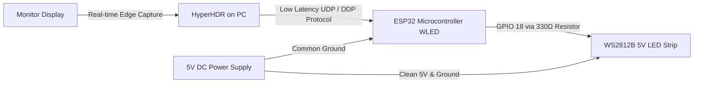

# DIY Monitor Sync Ambient Light (Ambilight) 🌈🖥️

A low-latency, real-time reactive bias lighting system for PC monitors and TVs built using an **ESP32**, **WS2812B addressable LED strip**, **WLED firmware**, and **HyperHDR**. 

This system captures display edge colors directly on the host computer with hardware acceleration (PipeWire / DXGI) and streams them wirelessly over local Wi-Fi to the ESP32 via high-speed UDP/DDP protocols with sub-50ms latency.

---

## 📌 Architecture Overview



---

## ⚡ Highlights

- **Sub-50ms Latency:** Fluid real-time color tracking for gaming, movies, and desktop applications.
- **Cross-Platform:** Works natively on **Linux (Wayland with PipeWire / X11)**, **Windows (DXGI)**, and **macOS**.
- **Budget-Friendly:** Built for a fraction of the cost of commercial alternatives (e.g. Philips Hue Play Gradient).
- **Safety Protected:** Built-in hardware data-line damping resistor and software power limiter to safeguard both the LEDs and power supply.
- **Standalone Smart Lights:** Switch instantly to warm reading light, night light, or 100+ dynamic effects via the WLED smartphone app / web dashboard when the PC is off.

---

## 🧰 Bill of Materials (BOM)

| Component | Specification | Function |
| :--- | :--- | :--- |
| **ESP32 Dev Board** | ESP32-WROOM-32 or ESP32-S3 | Wi-Fi microcontroller running WLED firmware |
| **WS2812B LED Strip** | 5V DC, 60 LEDs/m, IP20 (non-waterproof) | Individually addressable RGB LEDs |
| **Power Supply** | 5V DC (1A to 3A depending on LED count) | Powers the LED strip safely |
| **Damping Resistor** | 330 Ω to 470 Ω (1/4 Watt) | Placed on the data line to prevent voltage ringing & noise |
| **Hookup Wires** | 20–22 AWG silicone wires / 3-pin JST-SM | For power, ground, and data connections |
| **USB Cable** | Micro-USB or Type-C (Data capable) | For flashing firmware and initial power |

---

## 📐 Sizing & LED Calculation

For addressable LED strips with 60 LEDs per meter:
$$\text{Total LEDs} = \text{Perimeter in meters} \times 60$$

Mount the strips **5 to 8 cm (2 to 3 inches) inset from the outer monitor bezel** to achieve uniform wall diffusion without visible individual hotspots.

### Typical Dimensions for 16:9 Displays (All 4 Sides):
- **24" Monitor:** ~1.8 m $\rightarrow$ ~108–114 LEDs (Top: 34, Bottom: 34, Sides: 22 each)
- **27" Monitor:** ~1.9 m $\rightarrow$ ~120 LEDs (Top: 36, Bottom: 36, Sides: 24 each)
- **32" Monitor:** ~2.3 m $\rightarrow$ ~138 LEDs (Top: 42, Bottom: 42, Sides: 27 each)
- **34" Ultrawide (21:9):** ~2.5 m $\rightarrow$ ~150 LEDs (Top: 52, Bottom: 52, Sides: 23 each)

---

## 🔌 Wiring & Circuit Schematic

```
                          ┌──────────────────────────┐
                          │ 330 Ω Damping Resistor   │
   ESP32 Pin D18 (GPIO18) ┼───[ 330 Ω ]──────────────┼──── Strip GREEN Wire (DIN)
                          └──────────────────────────┘

   ESP32 Pin GND ────────────────┬──────────────────────── Strip WHITE Wire (GND)
                                 │
   5V Power Supply (-) ──────────┘ (Common Ground)

   5V Power Supply (+) ─────────────────────────────────── Strip RED Wire (+5V)
```

### ⚠️ Crucial Wiring Invariants:
1. **Direction of Data:** WS2812B data transmission is strictly directional. Observe the printed arrows `>>>` on the strip. The arrow must point **away from the ESP32** down the length of the strip.
2. **Common Ground:** The ground (GND) of the ESP32 and the ground of the external 5V power supply **must be connected together** to maintain a consistent logic reference.
3. **Resistor Placement:** Keep the 330 Ω resistor as close to the strip's first LED input (`DIN`) as possible to damp line reflections.
4. **Voltage Safety:** Never apply more than 5V DC to WS2812B strips. A 12V supply will instantly burn out the IC controllers.

---

## 🚀 Step-by-Step Installation

### Step 1: Flash WLED Firmware onto ESP32
1. Plug the ESP32 into your computer via a USB data cable.
2. If on Linux, ensure your user has read/write permissions for the serial device:
   ```bash
   sudo chmod 666 /dev/ttyUSB0
   sudo usermod -a -G uucp $USER
   ```
3. Open Chrome or Edge and go to [install.wled.me](https://install.wled.me).
4. Select the latest release, click **Install**, select your serial port (`/dev/ttyUSB0` or `COMx`), and complete installation.
5. In the post-install prompt, connect the ESP32 to your **2.4 GHz Wi-Fi network** (ESP32 hardware does not support 5 GHz).
6. Note the assigned local IP address (e.g. `172.24.203.19`).

### Step 2: Configure WLED LED Preferences
1. Open the WLED dashboard in your browser: `http://<ESP32_IP>`
2. Navigate to **Config (⚙️)** $\rightarrow$ **LED Preferences**:
   - **LED Outputs:** `WS281x`
   - **Color Order:** `GRB` (standard for WS2812B)
   - **Data GPIO:** `18` (matches physical pin D18)
   - **Length:** `120` (or your exact total LED count)
   - **Maximum PSU Current:** Set to `850 mA` for 1A supplies, `1600 mA` for 2A supplies, or `2400 mA` for 3A supplies.
3. Click **Save**.

### Step 3: Install & Configure HyperHDR on PC
1. Download and install HyperHDR from [GitHub Releases](https://github.com/awawa-dev/HyperHDR/releases).
2. Launch HyperHDR and open the Web UI at `http://localhost:8090`.
3. In **LED Hardware $\rightarrow$ LED Controller**:
   - **Controller type:** `wled` (or `udpddp`)
   - **Target IP / Hostname:** Enter your ESP32's IP address.
   - Click **Save settings**.
4. In **LED Hardware $\rightarrow$ LED Layout**:
   - Configure counts: `Top: 36`, `Bottom: 36`, `Left: 24`, `Right: 24` (total 120).
   - Set the starting corner and direction (clockwise/counter-clockwise) to match your physical routing.
   - Click **Save settings**.
5. In **Video capturing**:
   - Disable **USB Capture** (uncheck).
   - Enable **System Screen Capture** (check).
   - On Linux Wayland desktops, launch HyperHDR with PipeWire support:
     ```bash
     hyperhdr --pipewire --service
     ```
   - Click **Save settings** and approve the screen-sharing prompt if displayed.

---

## 🛠️ Physical Mounting & Corner Routing

1. Clean the back perimeter of the monitor with isopropyl alcohol.
2. Peel the 3M adhesive backing and apply the strip along the edges.
3. **Corner Handling:**
   - *Never bend the strip with a sharp 90° flat fold* (this cracks the thin internal copper traces).
   - **Option 1 (Continuous Loop):** Make a gentle rounded arch loop at each corner without cutting.
   - **Option 2 (Solder Jumpers):** Cut only at the marked copper cut pads and solder 3 short, flexible wires across each corner.
   - **Option 3 (Corner Connectors):** Use 3-pin solderless L-shaped snap connectors.

---

## 🔍 Troubleshooting

| Issue | Cause | Fix |
| :--- | :--- | :--- |
| **Strip stays completely dark** | Incorrect GPIO pin assignment in firmware | Ensure WLED **LED Preferences** has Data GPIO set to `18`, matching physical pin D18. |
| **First LEDs flicker or show erratic colors** | Missing data resistor or ground bounce | Add 330 Ω resistor on data line; ensure ESP32 GND and power supply GND are tied together. |
| **ESP32 cannot find or connect to Wi-Fi** | Wi-Fi network is 5 GHz | ESP32 only supports 2.4 GHz 802.11b/g/n. Use 2.4 GHz band or phone hotspot. |
| **Chrome fails to open serial port on Linux** | Serial device permission restriction | Run `sudo chmod 666 /dev/ttyUSB0` or add user to `uucp` / `dialout` group. |
| **Linux Wayland screen capture stays black** | X11 grabber used on Wayland session | Start HyperHDR with PipeWire support: `hyperhdr --pipewire --service`. |
| **ESP32 reboots during full-white scenes** | Power supply voltage sag (brownout) | Lower brightness in WLED or increase power limiter setting with an adequate 5V 2A–3A supply. |

---

## 📄 License

This project is licensed under the [MIT License](LICENSE).
Author: **Ronak Gupta**
